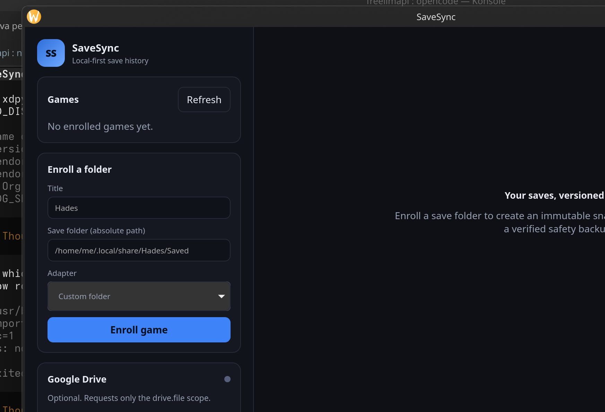

# SaveSync Desktop

Tauri 2 shell and React UI for the `savesync-core` engine: game enrollment,
immutable snapshots, staged restores, DAG conflict resolution, and optional
Google Drive sync.



## Quick start

Prerequisites:

- Rust 1.99+
- Node.js 20.19+ (Vite 8)
- Linux: `webkit2gtk-4.1`, `javascriptcoregtk-4.1`, `libsoup-3.0` development packages
- Windows 11: WebView2 (installed by default on current builds)
- A Google OAuth **Desktop app** client (only for Drive sync)

```bash
npm install
./scripts/dev.sh
```

`dev.sh` starts Vite on `127.0.0.1:1420` and then runs the Tauri debug shell.

> **Why "Connection refused" on 127.0.0.1?**
> A debug Tauri build loads `build.devUrl` (`http://127.0.0.1:1420`). Running
> `cargo run` or the debug binary without Vite produces that error by design.
> Use `./scripts/dev.sh` (or `npm run tauri dev` with the Tauri CLI), or build a
> release binary that embeds the frontend.

Build a self-contained binary:

```bash
./scripts/build.sh
# src-tauri/target/release/savesync-desktop
```

Installers require the Tauri CLI (`cargo install tauri-cli` or `npm install`):

```bash
npm run tauri build
```

## Google Drive setup

1. In Google Cloud Console create an OAuth client of type **Desktop app**.
2. Paste the client id into **Google Drive → OAuth client id** in SaveSync.
3. Click **Connect Drive**. SaveSync opens the system browser and listens on a
   random `127.0.0.1` port.
4. The loopback listener validates the `state` parameter and exchanges the code
   with the PKCE verifier. The refresh token is written to the OS keyring.

Notes:

- Only `https://www.googleapis.com/auth/drive.file` is requested.
- Files live in the app-only `appDataFolder`; SaveSync cannot read other Drive
  files.
- If Google issues a client secret, set `SAVESYNC_GOOGLE_CLIENT_SECRET` before
  launching. Public PKCE clients without a secret work as-is.
- Tokens never enter SQLite. Linux requires a Secret Service provider (GNOME
  Keyring/KWallet); Windows uses Credential Manager, macOS uses Keychain.
- Headless development fallback: `SAVESYNC_MEMORY_TOKENS=1` keeps tokens in
  memory only. Never use this for real data.

## Data location

The engine data directory is resolved in this order:

1. `SAVESYNC_DATA_DIR` environment variable.
2. Tauri app data dir + `/savesync`, e.g. on Linux
   `~/.local/share/app.savesync.desktop/savesync`.

It contains `savesync.db`, `blobs/`, `staging/`, and `rollback/`. The rollback
directory holds verified pre-restore backups and is never deleted automatically.

## What the UI does

- Enroll an existing absolute save folder (manual, no auto-discovery).
- Create a snapshot with an optional label; every file is SHA-256 verified.
- Browse the revision timeline and restore either:
  - **Restore** (overlay): write snapshot files, keep unrelated live files.
  - **Exact restore**: make the folder match the snapshot, deleting extras
    (all deletions are preserved in the safety backup).
- Resolve divergent heads by choosing a snapshot; a two-parent resolution
  commit is created and nothing is applied until you restore it.
- Connect/disconnect Google Drive and run **Sync now** per game.

## Development notes

- `src/tauri.ts` is a tiny wrapper around `window.__TAURI_INTERNALS__`. It exists
  because `@tauri-apps/api` is not vendored in this workspace; replace it with
  the official package when the registry is available.
- Commands are defined in `src-tauri/src/lib.rs`; all mutations delegate to
  `SaveSyncEngine`, so the safety invariants live in one place.
- `SAVESYNC_MEMORY_TOKENS=1` and `SAVESYNC_DATA_DIR=/tmp/...` are useful for
  smoke tests.

## Verification

```bash
npm run build                 # TypeScript + Vite production build
cd src-tauri
cargo fmt --all -- --check
cargo clippy --all-targets -- -D warnings
cargo test
```
